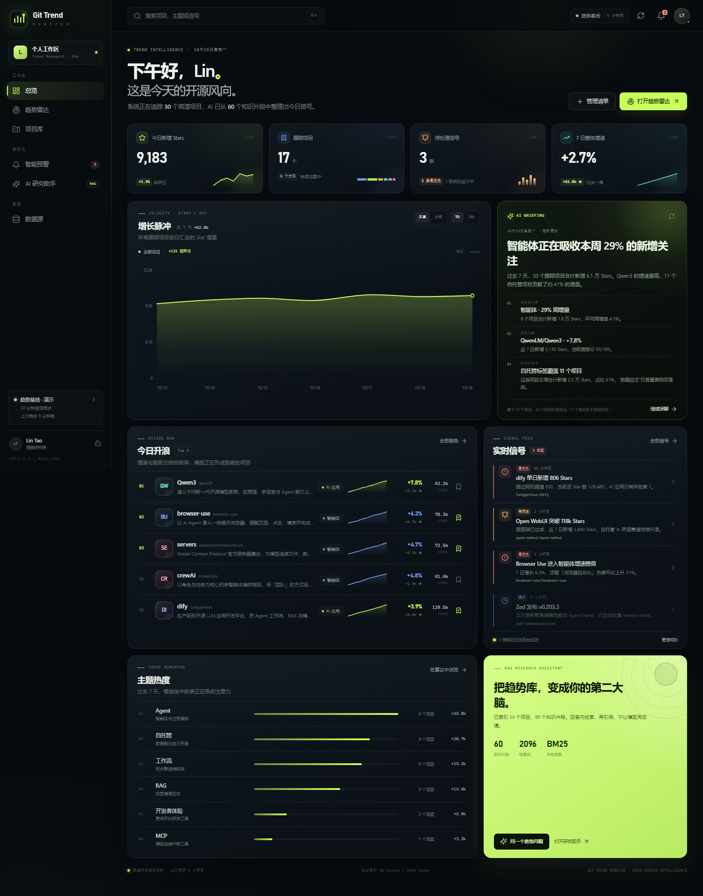
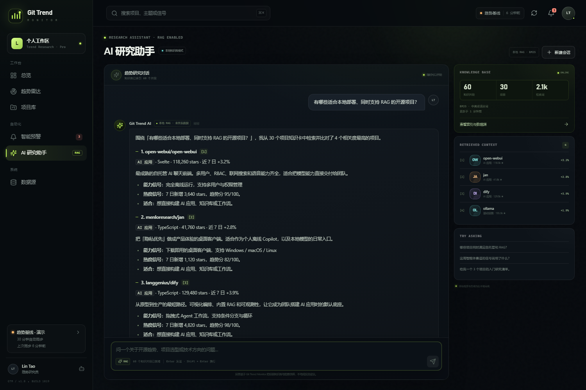

# Git Trend Monitor

**面向开发者与技术趋势研究者的 GitHub 热门项目全景仪表盘。**

自动追踪高潜开源项目，用规则引擎盯住增速拐点，并通过内置的 RAG 研究助手把项目知识库变成可追问、带引用的第二大脑。



---

## 为什么做这个项目

GitHub 的注意力信号分散在 Stars、Forks、Issue、版本发布和社区话题里。单看一个榜单只能看到“现在很火”，却很难回答：

- 哪些项目正在加速，而不是已经被充分定价？
- 这个赛道是单点爆发，还是连续多周期升温？
- 它适合本地部署、团队协作，还是个人探索？
- 我的关注清单、预警规则和研究笔记，放在哪里？

Git Trend Monitor 把发现、跟踪、预警和研究放进同一套工作流。

## 核心功能

| 模块 | 能力 |
| --- | --- |
| **总览** | 今日新增 Stars、跟踪池、未读信号、7 日增速；全站增长脉冲；AI 趋势晨报；今日升浪；实时信号流；主题热度 |
| **趋势雷达** | 增速 × 体量 × Forks 的机会象限；分类 / 语言 / 只看跟踪筛选；趋势分、增速、总 Stars 排序；项目详情抽屉 |
| **项目库** | 跟踪状态管理（重点关注 / 观察中 / 评估中）；自定义标签；研究备注；CSV 导出；分页表格与移动端卡片 |
| **智能预警** | 可配置规则（单日 Stars、7 日增速、Stars 里程碑、话题热度、活跃更新）；作用域；站内信号；可选 Webhook；信号时间线与已读管理 |
| **AI 研究助手** | 本地 BM25 RAG；项目知识卡检索；逐字流式输出；编号引用；项目对比、趋势解读、概念解释；可选 DeepSeek / OpenAI 兼容模型 |
| **数据源** | GitHub 公共 API / Token 同步；自动同步频率；同步记录；RAG 索引重建；运行模式与健康状态 |

全站响应式适配桌面、平板与手机；桌面端提供 `⌘/Ctrl + K` 全局命令面板。

## 快速开始

环境要求：**Node.js ≥ 20**、**pnpm ≥ 9**。

```bash
pnpm install
cp .env.example .env      # Windows: Copy-Item .env.example .env
pnpm dev
```

打开：

- 前端：<http://127.0.0.1:5173>
- API：<http://127.0.0.1:8787>

生产模式：

```bash
pnpm build
pnpm start
```

打开 <http://127.0.0.1:8787>。Express 会同时提供构建后的前端与 API。

> 国内网络环境在 `.npmrc` 中预置了 npmmirror 源。如需切换回官方源，删除 `registry` 配置即可。

## 数据模式

### 演示基线

首次启动会自动载入 **30 个真实开源项目**的种子快照。项目描述、分类与相对热度用于展示产品能力；30 天 Stars 序列为演示用基线。侧边栏与数据源页面会明确显示「趋势基线 · 演示」。

无需任何密钥即可体验所有功能：总览、雷达、项目库、预警、RAG 问答。

### 实时 GitHub 数据

- 点击右上角同步按钮，或前往「数据源 → 立即同步」。
- 系统通过 GitHub REST API 搜索近 45 天内创建、Stars 超过 500 的新晋项目。
- 已存在的项目会更新 Stars、Forks、Issues 与 topics；新项目以首次快照作为基线，避免把全量 Stars 误算成单日增长。
- 配置 `GITHUB_TOKEN` 后，速率上限从 60 次/小时提升到 5,000 次/小时。
- 默认每 30 分钟自动同步一次，可在「数据源」中暂停或调整频率（5 分钟 – 24 小时）。

> 自动同步、规则评估与知识索引重建均由本地 Node.js 服务完成，关闭浏览器不会停止。

### 重置演示数据

```bash
# 先停止服务
rm server/data/state.json     # Windows: Remove-Item server/data/state.json
pnpm start
```

## RAG 架构



Git Trend Monitor 的 RAG 不是“把问题直接丢给模型”，而是一条完整的检索链：

```
用户问题
  → 中英双语分词 + 查询扩展（本地 / 离线 / RAG / Agent …）
  → BM25 检索项目知识片段
  → 取回 Top-K 项目 + 摘要 + 能力标签 + 趋势快照
  → 本地答案生成，或把检索上下文交给远程模型
  → 生成带 [1][2] 引用的回答
  → 前端展示引用来源，可点击回到项目详情
```

**索引内容**

- 每个项目至少 2 个片段：项目概览、能力与适用场景。
- 从 GitHub 同步到 README 后，会额外建立 README 片段。
- 索引由项目摘要、分类、语言、Stars、近 7 日增量、主题标签、适用场景与能力清单构成。

**为什么用 BM25**

项目名、技术名词和精确关键词很多。BM25 无需 embedding 服务，部署成本低、结果可解释，并支持中英混合查询。中文使用双字切分 + 查询同义词扩展。

**两种生成模式**

| 模式 | 行为 | 隐私边界 |
| --- | --- | --- |
| 本地 RAG（默认） | 基于检索结果与趋势聚合生成结构化回答 | 不出本机 |
| 远程模型（可选） | 检索仍在本地完成，只把命中的项目上下文发给模型 | 仅发送检索上下文 |

配置 `DEEPSEEK_API_KEY` 或 `AI_API_KEY` 后自动启用远程模式。项目详情、对比、趋势聚合与概念解释仍由确定性的本地模板生成，以保证数据和引用一致；开放式推荐与追问会交给远程模型。若远程调用失败，会自动回退到本地 RAG，并在回答中标注。

## 预警引擎

每次同步后，所有启用的规则都会执行：

| 指标 | 说明 |
| --- | --- |
| `dailyStars` | 单日新增 Stars |
| `weeklyGrowthPct` | 近 7 日增速 |
| `stars` | 总 Stars 里程碑（同一项目不重复触发） |
| `topicGrowth` | 指定分类的平均周增速 |
| `release` | 项目在统计窗口内出现新的代码更新 |

- 作用域支持全部跟踪项目、重点关注项目或单个技术分类。
- 命中后生成站内信号，并更新规则的触发次数与最近触发时间。
- 配置 `ALERT_WEBHOOK_URL` 且规则勾选 Webhook 时，会推送 JSON 到该地址；失败会记录在活动日志中。
- 站内信号保留最近 50 条，可单条或全部标记已读。

Webhook 负载示例：

```json
{
  "source": "git-trend-monitor",
  "rule": { "id": "rule-id", "name": "AI 项目单日异动", "metric": "dailyStars" },
  "event": {
    "id": "event-id",
    "title": "dify 单日新增 806 Stars",
    "message": "规则命中：当前总 Star 数 129,480，阈值 550。",
    "severity": "high",
    "createdAt": "2026-10-19T09:26:34.359Z"
  },
  "project": {
    "fullName": "langgenius/dify",
    "category": "AI 应用",
    "stars": 129480,
    "weeklyGrowthPct": 3.9,
    "url": "https://github.com/langgenius/dify"
  }
}
```

## 技术栈

- **前端**：React 18、TypeScript、Vite、React Router、Lucide Icons
- **可视化**：原生 SVG 曲线、机会象限气泡图、Sparkline，无图表库依赖
- **后端**：Node.js、Express、SSE
- **数据**：本地 JSON 持久化（`server/data/state.json`）
- **检索**：自实现 BM25 + 中英双语分词 + 同义词扩展
- **模型**：OpenAI Chat Completions 兼容接口（DeepSeek 默认）
- **样式**：手写 CSS 设计系统，深色观测台视觉、全站响应式

## 架构

```
┌─────────────────────────────────────────────────────────┐
│ React + Vite SPA                                        │
│ 总览 / 趋势雷达 / 项目库 / 智能预警 / AI 助手 / 数据源    │
└───────────────┬──────────────────────────┬──────────────┘
                │ REST                     │ SSE (/api/chat)
┌───────────────▼──────────────────────────▼──────────────┐
│ Express API                                             │
│                                                         │
│  ├── 项目 / 跟踪 / 标签 / 备注        JSON Store        │
│  ├── 预警规则 + 规则评估引擎          state.json        │
│  ├── GitHub 同步调度器               定时任务           │
│  ├── BM25 知识索引                   内存索引           │
│  └── RAG 回答器 ── 本地模板 / 远程模型                  │
└───────────────┬──────────────────────────┬──────────────┘
                │                          │
       GitHub REST API              OpenAI-compatible API
                                      （可选）
```

## 项目结构

```
.
├── server/
│   ├── index.js          # Express 路由、总览聚合、SSE 对话
│   ├── seed.js           # 30 个项目的演示基线
│   ├── store.js          # JSON 持久化与活动记录
│   ├── ingest.js         # GitHub 同步、规则引擎、Webhook
│   ├── rag.js            # 文档切片、分词、BM25 检索
│   └── assistant.js      # 意图识别、本地回答、远程模型调用
├── src/
│   ├── components/       # Shell、图表、项目抽屉、命令面板…
│   ├── pages/            # 六个主页面
│   ├── context/          # 全局状态、Toast、项目抽屉
│   ├── lib/              # API、类型、格式化、图表工具
│   └── styles.css        # 设计系统与响应式样式
├── scripts/
│   ├── chat-smoke.mjs    # 六种 RAG 意图的端到端检查
│   └── visual-test.mjs   # 桌面 / 移动端截图与溢出检查
├── docs/                 # README 用截图
├── .env.example
└── package.json
```

## API 速览

| Method | Path | 说明 |
| --- | --- | --- |
| `GET` | `/api/overview` | KPI、趋势序列、分类、主题、简报、机会点、信号 |
| `GET` | `/api/projects` | 项目列表；支持 `query/category/language/tracked/sort` |
| `GET` | `/api/projects/:id` | 项目详情与同类项目 |
| `PATCH` | `/api/projects/:id` | 更新跟踪状态、标签、备注 |
| `GET` | `/api/alerts` | 规则与信号 |
| `POST` | `/api/alerts` | 创建规则 |
| `PATCH` | `/api/alerts/:id` | 启停 / 修改规则 |
| `DELETE` | `/api/alerts/:id` | 删除规则 |
| `POST` | `/api/alerts/events/read` | 标记已读；可传 `ids` |
| `GET` | `/api/sources` | 数据源、模型、RAG 索引与同步记录 |
| `POST` | `/api/sync` | 立即同步 GitHub |
| `PATCH` | `/api/settings` | 自动同步与频率 |
| `POST` | `/api/rag/reindex` | 重建本地知识索引 |
| `POST` | `/api/chat` | SSE 流式 RAG 对话 |
| `GET` | `/api/health` | 健康检查 |

### Chat SSE 事件

```text
event: retrieving   → 正在检索
event: meta         → 模式、模型、引用来源、索引状态
event: delta        → 增量文本
event: done         → 会话结束
event: error        → 错误信息
```

## 环境变量

| 变量 | 必填 | 默认值 | 说明 |
| --- | --- | --- | --- |
| `PORT` | 否 | `8787` | 服务端口 |
| `HOST` | 否 | `127.0.0.1` | 监听地址；仅本地访问更安全 |
| `DATA_DIR` | 否 | `server/data` | 数据持久化目录 |
| `GITHUB_TOKEN` | 否 | — | GitHub Personal Access Token |
| `DEEPSEEK_API_KEY` / `AI_API_KEY` | 否 | — | 远程模型密钥；留空走本地 RAG |
| `DEEPSEEK_BASE_URL` / `AI_BASE_URL` | 否 | `https://api.deepseek.com` | OpenAI 兼容 API 地址 |
| `DEEPSEEK_MODEL` / `AI_MODEL` | 否 | `deepseek-chat` | 模型名称 |
| `AI_PROVIDER_NAME` | 否 | `DeepSeek` / `自定义模型` | 前端展示的模型来源 |
| `ALERT_WEBHOOK_URL` | 否 | — | 预警 Webhook 接收地址 |

密钥只由 Node 服务读取，不会发送到浏览器。

## 测试

先启动服务，然后：

```bash
pnpm test:chat
```

会检查推荐、趋势、对比、概念解释、项目详情、通用问答六类问题，验证 SSE、引用与格式。

视觉回归检查需要本机 Chrome 或 Edge：

```bash
pnpm test:ui
```

截图输出到 `screenshots/`，同时检查横向溢出与浏览器控制台错误。可通过 `TEST_BASE` 和 `BROWSER_PATH` 指向其他服务或浏览器。

## 设计与工程取舍

- **不做重型图表库**：增长曲线、气泡象限与 Sparkline 都由 SVG 绘制，减少依赖并保持视觉一致。
- **本地优先**：不配置模型也能完整运行；RAG 的检索与回答都在本机完成。
- **有证据的 AI**：回答附带项目编号引用，前端可直接打开对应项目。
- **数据透明**：演示基线与实时数据在 UI 中明确区分；新项目首日不计入“今日增长”。
- **可解释的规则**：每条预警都记录规则、项目、阈值与触发时间，而不是只给一个分数。

## 已知边界

- JSON 文件存储适合个人和小团队单实例部署；多实例或高并发场景建议替换为 PostgreSQL / Redis。
- GitHub 搜索不提供官方“trending API”，实时发现基于近期创建 + Stars 排序的近似策略。
- 本地 RAG 回答是可解释的检索式生成，不等同于大模型生成；需要更自然的表达时配置远程模型。
- 服务默认仅监听 `127.0.0.1`，不包含用户系统与鉴权；不要直接暴露到公网。
- 预警通知目前提供站内信号与可选 Webhook，不包含 SMTP 邮件发送。

## License

[MIT](LICENSE)
